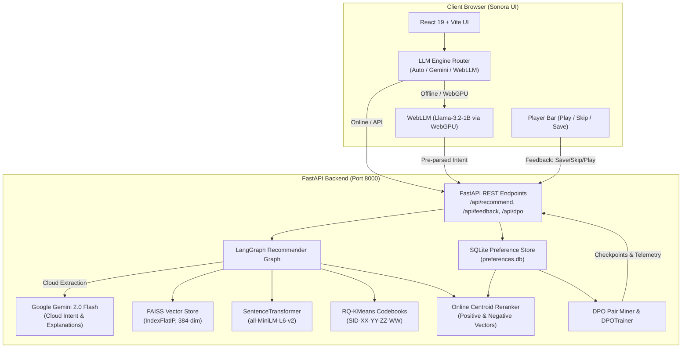

# Sonora: Language-Steerable Music Discovery System

<div align="center">


**A next-generation music discovery platform inspired by Spotify NEO and Spotify GLIDE.**  
*Combines Hierarchical Semantic IDs (RQ-KMeans), Vector Quantization, LangGraph Multi-Step Reasoning, Dual-Engine LLM Intelligence (Google Gemini 2.0 Flash + Offline WebLLM WebGPU), and a Two-Tier DPO Preference Flywheel.*

---

[](https://www.python.org/)
[](https://fastapi.tiangolo.com/)
[](https://react.dev/)
[](https://vitejs.dev/)
[](https://ai.google.dev/)
[](https://langchain-ai.github.io/langgraph/)
[](https://github.com/facebookresearch/faiss)
[](https://webllm.mlc.ai/)
[](https://huggingface.co/docs/trl/)
[]()

</div>

---

## Table of Contents

- [1. Overview & Vision](#1-overview--vision)
- [2. Core Architectural Pillars](#2-core-architectural-pillars)
  - [A. Spotify NEO-Inspired Hierarchical Semantic IDs (RQ-KMeans)](#a-spotify-neo-inspired-hierarchical-semantic-ids-rq-kmeans)
  - [B. Spotify GLIDE Non-Habitual Discovery (MMR Diversity)](#b-spotify-glide-non-habitual-discovery-mmr-diversity)
  - [C. LangGraph Orchestrated Recommendation Agent](#c-langgraph-orchestrated-recommendation-agent)
  - [D. Dual-Engine LLM Architecture (Gemini Cloud + WebLLM WebGPU)](#d-dual-engine-llm-architecture-gemini-cloud--webllm-webgpu)
  - [E. Two-Tier Preference Flywheel & Offline DPO Alignment](#e-two-tier-preference-flywheel--offline-dpo-alignment)
  - [F. Minimalist Dark-Mode Frontend (Sonora UI)](#f-minimalist-dark-mode-frontend-sonora-ui)
- [3. System Architecture Diagram](#3-system-architecture-diagram)
- [4. Project Structure](#4-project-structure)
- [5. API Reference & Endpoints](#5-api-reference--endpoints)
- [6. Getting Started & Installation](#6-getting-started--installation)
  - [Prerequisites](#prerequisites)
  - [Backend Setup](#backend-setup)
  - [Data Ingestion & Index Building](#data-ingestion--index-building)
  - [Frontend Setup](#frontend-setup)
- [7. Running the Application](#7-running-the-application)
- [8. Dual-Engine Intelligence & Offline Mode](#8-dual-engine-intelligence--offline-mode)
- [9. Preference Flywheel & DPO Training Pipeline](#9-preference-flywheel--dpo-training-pipeline)
- [10. Testing & Verification](#10-testing--verification)
- [11. Technical Specifications](#11-technical-specifications)
- [12. Acknowledgements & References](#12-acknowledgements--references)

---

## 1. Overview & Vision

Conventional music recommendation algorithms suffer from a critical flaw: **the habit loop**. By constantly optimizing for immediate engagement and historical familiarity, systems trap listeners in repetitive comfort bubbles. Furthermore, standard database identifiers (e.g. `track_89213`) are arbitrary tokens devoid of acoustic or semantic meaning.

**Sonora** solves these limitations by implementing Spotify's newest research architectures:

1. **Unified Catalog Tokenization (Spotify NEO)**: Ingests 20+ musical genres with standardized acoustic features and tokenizes tracks into structured **Semantic IDs** (`SID-XX-YY-ZZ-WW`) using 4-level Residual Quantization K-Means (RQ-KMeans).
2. **Serendipitous Discovery (Spotify GLIDE)**: Employs Maximal Marginal Relevance (MMR) with a live switch between **Familiar Mode** ($\lambda = 1.0$) for focused relevance and **Explore Mode** ($\lambda = 0.45$) to break habitual listening cycles.
3. **Conversational Multi-Step Agent**: Uses **LangGraph** to parse user intent, map acoustic boundaries, perform vector search, filter candidates, and generate grounded justifications.
4. **Dual-Engine Language Intelligence**: Combines **Google Gemini 2.0 Flash** for cloud inference with in-browser **WebLLM** (`Llama-3.2-1B` via WebGPU) for 100% offline, zero-cloud-cost, privacy-preserving recommendations.
5. **Two-Tier Preference Flywheel**: Online real-time taste centroid adaptation (Tier 1) coupled with offline Direct Preference Optimization (DPO) triplet mining and TRL training (Tier 2).

---

## 2. Core Architectural Pillars

### A. Spotify NEO-Inspired Hierarchical Semantic IDs (RQ-KMeans)

Arbitrary track IDs carry zero acoustic context for language models. Sonora adopts Spotify NEO's vector quantization paradigm:

- **7-Dimensional Psychoacoustic Feature Vector**:
  $$\mathbf{x} = [\text{danceability}, \text{energy}, \text{valence}, \text{acousticness}, \text{instrumentalness}, \text{tempo\_norm}, \text{loudness\_norm}] \in [0, 1]^7$$
- **Hierarchical Residual Quantization (RQ-KMeans)**:
  - **Level 1 ($C_1$, $K=32$)**: Macro Acoustic Profile / Primary Genre Texture ($c_1 = \arg\min \|x - c\|^2$, residual $r_1 = x - c_1$)
  - **Level 2 ($C_2$, $K=32$)**: Sub-Genre / Instrumentation Color ($c_2 = \arg\min \|r_1 - c\|^2$, residual $r_2 = r_1 - c_2$)
  - **Level 3 ($C_3$, $K=32$)**: Emotional Nuance / Sonic Atmosphere ($c_3 = \arg\min \|r_2 - c\|^2$, residual $r_3 = r_2 - c_3$)
  - **Level 4 ($C_4$, $K=32$)**: Fine-Grained Track Discrimination ($c_4 = \arg\min \|r_3 - c\|^2$)
- **Output Token**: Zero-padded string token `SID-XX-YY-ZZ-WW` (e.g., `SID-03-17-09-24`). Acoustically similar tracks naturally share token prefixes.

### B. Spotify GLIDE Non-Habitual Discovery (MMR Diversity)

To balance immediate relevance with serendipitous exploration, Sonora implements Spotify GLIDE's non-habitual discovery engine via Maximal Marginal Relevance (MMR):

$$\text{MMR}(q, D, R) = \operatorname{argmax}_{d_i \in D \setminus R} \left[ \lambda \cdot \operatorname{Sim}_1(d_i, q) - (1 - \lambda) \cdot \max_{d_j \in R} \operatorname{Sim}_2(d_i, d_j) \right]$$

- **Familiar Mode ($\lambda = 1.0$)**: Pure exploitation. Maximizes cosine match to the user's prompt.
- **Explore Mode ($\lambda = 0.45$)**: Exploration. Actively penalizes redundancy to surface non-habitual acoustic variations and diverse genres without violating the contextual mood.

### C. LangGraph Orchestrated Recommendation Agent

A stateful directed acyclic recommendation graph (`backend/app/agent/graph.py`) orchestrates the end-to-end recommendation workflow:

```
[Start]
   │
   ▼
[1. Parse Intent Node] ───► Extract mood, acoustic bounds, tempo, genre affinities, dense query
   │
   ▼
[2. Retrieve Candidates] ─► Query FAISS IndexFlatIP (384-dim normalized cosine search)
   │
   ▼
[3. Filter Tracks] ───────► Enforce psychoacoustic boundaries (energy, tempo, acousticness)
   │
   ▼
[4. Rerank Tracks] ───────► Apply GLIDE MMR (Familiar vs. Explore Mode)
   │
   ▼
[5. Explain Tracks] ──────► Grounded personal justifications referencing Semantic IDs
   │
   ▼
 [End]
```

### D. Dual-Engine LLM Architecture (Gemini Cloud + WebLLM WebGPU)

Sonora features a hybrid intelligence routing layer:

1. **Cloud Engine**: **Google Gemini 2.0 Flash** via the FastAPI backend (`langchain-google-genai` / `google-genai`). Delivers high-nuance semantic intent extraction and creative psychoacoustic explanations.
2. **Offline Engine**: **WebLLM** (`@mlc-ai/web-llm`) running client-side in the browser via **WebGPU**. Runs `Llama-3.2-1B-Instruct-q4f16_1-MLC` with zero cloud API calls, zero server load, and 100% offline privacy.
3. **Adaptive Router & Fallback Ladder**:
   - `Gemini Cloud Active`: Primary online path.
   - `Offline / Network Drop / Missing Key`: Seamlessly routes to client-side WebLLM via WebGPU.
   - `WebGPU Unsupported / Legacy Hardware`: Automatically falls back to deterministic heuristic parsing and rule-based explanations.
4. **Interactive Engine Switcher**: The UI includes an interactive engine selector (`Auto`, `Gemini 2.0 Flash`, `WebLLM Offline WebGPU`) with real-time download and cache progress bars.

### E. Two-Tier Preference Flywheel & Offline DPO Alignment

Listener feedback continuously steers recommendations across two time horizons:

- **Tier 1 (Online Preference Flywheel — Real-Time)**:
  - Actions logged immediately: **Save** ($+1.0$), **Replay** ($+1.5$), **Skip** ($-1.0$), **Play** ($+0.5$).
  - Updates 384-dimensional positive taste centroid ($\vec{C}_{\text{pos}}$) and negative taste centroid ($\vec{C}_{\text{neg}}$) stored in SQLite (`backend/data/preferences.db`).
  - Dynamically shifts candidate scores on the very next query:
    $$S_{\text{final}} = S_{\text{base}} + \alpha \cdot \cos(\mathbf{e}, \vec{C}_{\text{pos}}) - \beta \cdot \cos(\mathbf{e}, \vec{C}_{\text{neg}})$$
- **Tier 2 (Offline DPO Triplet Mining & TRL Training — Periodic)**:
  - Mines preference triplets $(x, y_w, y_l)$ where $x$ is the search query, $y_w$ is chosen (saved/replayed), and $y_l$ is rejected (skipped within the same session).
  - Trains an aligned language model using Hugging Face's `trl.DPOTrainer` with LoRA support and fast dry-run calibration.

### F. Minimalist Dark-Mode Frontend (Sonora UI)

The frontend is crafted with a minimalist dark aesthetic (`#101010`, `#181818`, accent lime `#c6ee7a`):
- **Search & Chips**: Natural language prompt input with curated starter chips.
- **GLIDE Mode Toggle**: One-click switch between Familiar and Explore modes.
- **Three Reactive Tabs**:
  - `Tracks`: Interactive cards with match score, Semantic ID badge, cover art, and acoustic radar metrics.
  - `Why these?`: Visual intent dimensions (mood, energy profile, genres, context) and agent reasoning.
  - `Signals & DPO`: Real-time interaction counters, interaction log, and interactive DPO training button.
- **Persistent Player Bar**: Artwork, play/pause, seek timeline, duration display, and save/favorite button.

---

## 3. System Architecture Diagram



---

## 4. Project Structure

```
music_recommader/
├── README.md                                # Project documentation
├── backend/
│   ├── .env.example                         # Example environment variables
│   ├── requirements.txt                     # Backend Python dependencies
│   ├── app/
│   │   ├── config.py                        # Pydantic BaseSettings & environment config
│   │   ├── main.py                          # FastAPI application & REST endpoints
│   │   ├── agent/                           # LangGraph Recommendation Agent
│   │   │   ├── graph.py                     # StateGraph assembly & compilation
│   │   │   ├── nodes.py                     # Graph nodes (intent, retrieve, filter, rerank, explain)
│   │   │   ├── prompts.py                   # System prompts & heuristic fallbacks
│   │   │   └── state.py                     # RecommenderState TypedDict definition
│   │   ├── core/                            # Core ML & Quantization Engines
│   │   │   ├── embeddings.py                # SentenceTransformer text embedding wrapper
│   │   │   ├── semantic_ids.py              # 4-level Hierarchical RQ-KMeans quantizer
│   │   │   └── vector_store.py              # FAISS IndexFlatIP & GLIDE MMR search
│   │   ├── models/
│   │   │   └── schemas.py                   # Pydantic v2 API request/response models
│   │   ├── preference/                      # Two-Tier Preference & DPO Flywheel
│   │   │   ├── dpo_trainer.py               # Hugging Face TRL DPOTrainer pipeline
│   │   │   ├── online_reranker.py           # Real-time online centroid taste reranker
│   │   │   ├── pair_miner.py                # Preference triplet mining & JSONL exporter
│   │   │   └── store.py                     # Parameterized SQLite interaction store
│   │   └── scripts/
│   │       ├── build_index.py               # Catalog indexing & codebook generator
│   │       └── download_or_seed_dataset.py  # Kaggle Spotify tracks seeder (20+ genres)
│   ├── data/                                # Catalog data & trained artifacts
│   │   ├── kaggle_spotify_tracks.csv        # Raw dataset with audio features
│   │   ├── catalog_indexed.csv              # Indexed catalog with Semantic IDs
│   │   ├── faiss_index.bin                  # Serialized FAISS IndexFlatIP
│   │   ├── faiss_metadata.pkl               # Serialized track metadata
│   │   ├── sid_codebooks.pkl                # Serialized RQ-KMeans cluster centroids
│   │   └── preferences.db                   # SQLite database for user signals
│   └── tests/                               # Comprehensive Pytest test suite
│       ├── test_agent.py                    # LangGraph workflow & prompt tests
│       ├── test_api.py                      # FastAPI endpoint tests
│       ├── test_dpo_pipeline.py             # DPO mining & training tests
│       ├── test_preference.py               # SQLite preference flywheel tests
│       ├── test_semantic_ids.py             # RQ-KMeans quantization tests
│       └── test_vector_store.py             # FAISS & GLIDE MMR retrieval tests
├── sonora-frontend/
│   ├── package.json                         # Frontend dependencies & scripts
│   ├── vite.config.js                       # Vite configuration
│   ├── index.html                           # HTML entry point with DM Sans typography
│   └── src/
│       ├── App.jsx                          # Main Sonora reactive UI component
│       ├── main.jsx                         # React 19 root mounting
│       ├── styles.css                       # Minimalist dark theme styles
│       ├── hooks/
│       │   └── useSonoraDiscovery.js        # State management & player orchestration hook
│       └── services/
│           ├── api.js                       # HTTP client for FastAPI backend
│           ├── llmRouter.js                 # Dual-Engine intelligent dispatcher
│           └── webllmService.js             # WebLLM WebGPU client-side engine
└── specs/                                   # Detailed Phase Architecture Specs
    ├── SPEC_01_DATASET_AND_SEMANTIC_IDS.md
    ├── SPEC_02_VECTOR_STORE_AND_GLIDE.md
    ├── SPEC_03_LANGGRAPH_GEMINI_AGENT.md
    ├── SPEC_04_PREFERENCE_FLYWHEEL_AND_DPO.md
    ├── SPEC_05_FASTAPI_BACKEND_API.md
    ├── SPEC_06_SONORA_FRONTEND_INTEGRATION.md
    └── SPEC_07_DUAL_LLM_WEBLLM_OFFLINE.md
```

---

## 5. API Reference & Endpoints

All backend endpoints are served under `/api` on `http://127.0.0.1:8000`:

| Method | Endpoint | Description |
|---|---|---|
| `GET` | `/api/health` | Healthcheck, indexed track count, active model telemetry. |
| `POST` | `/api/recommend` | Language-steered recommendations with Semantic IDs and explanations. |
| `POST` | `/api/feedback` | Log Save, Skip, Replay, or Play feedback to the SQLite flywheel. |
| `GET` | `/api/preferences/{user_id}` | Fetch user interaction statistics (saves, skips, plays) and recent history. |
| `GET` | `/api/dpo/pairs` | Inspect mined preference triplets `(prompt, chosen, rejected)`. |
| `POST` | `/api/dpo/train` | Execute Hugging Face TRL DPO training or dry-run calibration. |

### Example 1: Generate Recommendations (`POST /api/recommend`)

**Request**:
```json
{
  "query": "something calm for a 3 a.m. study session with soft piano",
  "discovery_mode": "familiar",
  "user_id": "listener_01",
  "limit": 8
}
```

**Response**:
```json
{
  "query": "something calm for a 3 a.m. study session with soft piano",
  "discovery_mode": "familiar",
  "tracks": [
    {
      "id": "SID-03-12-08-01",
      "track_id": "TRK-AMB-0042",
      "title": "A Midnight Echo",
      "artist": "Brian Eno",
      "album": "Atmospheres",
      "genre": "Ambient · Curated",
      "duration": "3:42",
      "duration_ms": 222000,
      "score": "94%",
      "numeric_score": 0.942,
      "semantic_id": "SID-03-12-08-01",
      "image": "photo-1500530855697-b586d89ba3ee",
      "reason": "Calm ambient piano at 68 BPM with minimal percussion (energy 18%), aligning with your late-night study context.",
      "audio_features": {
        "energy": 0.18,
        "valence": 0.28,
        "acousticness": 0.92,
        "danceability": 0.24,
        "instrumentalness": 0.88,
        "tempo": 68.0,
        "loudness": -21.4
      }
    }
  ],
  "intent_dimensions": [
    {"label": "Calm", "sub": "Emotional tone"},
    {"label": "25% Max", "sub": "Energy profile"},
    {"label": "Ambient", "sub": "Genre affinity"},
    {"label": "Late-Night Study", "sub": "Listening context"}
  ],
  "overall_reasoning": "Selected 8 tracks in Familiar mode matching low-energy study acoustics.",
  "retrieval_snapshot": {
    "intent_id": "INT-CAL-8",
    "catalog_id": "CAT-1200",
    "ranking_mode": "Hybrid (Semantic + Preference)",
    "retrieval": "FAISS IndexFlatIP (Cosine) + Gemini Reasoning"
  }
}
```

### Example 2: Log User Feedback (`POST /api/feedback`)

**Request**:
```json
{
  "user_id": "listener_01",
  "track_id": "TRK-AMB-0042",
  "track_name": "A Midnight Echo",
  "artists": "Brian Eno",
  "query": "something calm for a 3 a.m. study session",
  "action": "save",
  "semantic_id": "SID-03-12-08-01"
}
```

**Response**:
```json
{
  "status": "success",
  "action": "save",
  "weight": 1.0,
  "track_id": "TRK-AMB-0042",
  "user_id": "listener_01",
  "updated_stats": {
    "saved_count": 12,
    "skipped_count": 3,
    "played_count": 28,
    "total_interactions": 43
  }
}
```

---

## 6. Getting Started & Installation

### Prerequisites

- **Python 3.10+** (Tested with Python 3.10, 3.11, 3.12, 3.13)
- **Node.js 18+** & **npm**
- Modern Chromium-based browser (Google Chrome, Microsoft Edge, Brave) with WebGPU enabled (optional for offline WebLLM execution).
- *(Optional)* Google Gemini API key from [Google AI Studio](https://aistudio.google.com/). Sonora functions completely offline without an API key using the built-in heuristic parser or WebLLM.

---

### Backend Setup

1. **Clone the repository**:
   ```bash
   git clone https://github.com/your-username/music_recommader.git
   cd music_recommader
   ```

2. **Create and activate a Python virtual environment**:
   ```bash
   # Windows PowerShell
   python -m venv venv
   .\venv\Scripts\Activate.ps1

   # Linux / macOS
   python3 -m venv venv
   source venv/bin/activate
   ```

3. **Install dependencies**:
   ```bash
   pip install -r backend/requirements.txt
   ```

4. **Configure environment variables**:
   Create a `.env` file inside `backend/` (or copy from `backend/.env.example`):
   ```bash
   # Windows PowerShell
   Copy-Item backend\.env.example backend\.env

   # Linux / macOS
   cp backend/.env.example backend/.env
   ```
   Open `backend/.env` and optionally set your Gemini API key:
   ```env
   GEMINI_API_KEY="your-google-gemini-api-key-here"
   GEMINI_MODEL="gemini-2.0-flash"
   ```

---

### Data Ingestion & Index Building

The repository comes pre-indexed with 1,200 curated tracks across 20+ genres. If you want to re-seed or rebuild the vector index and RQ-KMeans codebooks from scratch:

```bash
# 1. Seed or fetch Kaggle Spotify tracks dataset
python -m backend.app.scripts.download_or_seed_dataset

# 2. Fit RQ-KMeans codebooks, encode descriptions, and build FAISS index
python -m backend.app.scripts.build_index
```

This generates:
- `backend/data/kaggle_spotify_tracks.csv`
- `backend/data/catalog_indexed.csv`
- `backend/data/faiss_index.bin`
- `backend/data/faiss_metadata.pkl`
- `backend/data/sid_codebooks.pkl`

---

### Frontend Setup

1. Navigate to the frontend directory:
   ```bash
   cd sonora-frontend
   ```

2. Install npm dependencies:
   ```bash
   npm install
   ```

---

## 7. Running the Application

### Option A: One-Click Automated Launchers (Recommended)

You can launch both the FastAPI backend, the React frontend, and your browser with a single command:

- **Windows**:
  Double-click **`start.bat`** or run:
  ```cmd
  .\start.bat
  ```
- **Linux / macOS / Git Bash**:
  ```bash
  chmod +x start.sh
  ./start.sh
  ```

> [!TIP]
> The startup scripts automatically verify Python and Node.js environments, activate your virtual environment if one exists, generate `.env` if missing, build missing indexes on first run, install frontend dependencies if needed, and automatically launch `http://localhost:5173` in your default browser.

---

### Option B: Manual Startup

#### 1. Launch the Backend Server

From the project root:
```bash
python -m uvicorn backend.app.main:app --reload --host 127.0.0.1 --port 8000
```
- API will be accessible at: `http://127.0.0.1:8000`
- Interactive OpenAPI Swagger documentation: `http://127.0.0.1:8000/docs`
- Healthcheck endpoint: `http://127.0.0.1:8000/api/health`

#### 2. Launch the React Frontend

In a separate terminal window:
```bash
cd sonora-frontend
npm run dev
```
- Sonora UI will be running at: `http://localhost:5173`

Open your browser to `http://localhost:5173`. You can immediately start exploring prompts like:
- *"something calm for a 3 a.m. study session with soft piano"*
- *"late night deep house focus"*
- *"cinematic post rock for mountain stargazing"*
- *"high energy gym workout hype tracks"*

---

## 8. Dual-Engine Intelligence & Offline Mode

Sonora provides true dual-engine execution controllable via the topbar dropdown:

```
[ LLM Engine: Auto ▼ ]
├── Auto (Adaptive Ladder)
├── Gemini 2.0 Flash (Cloud API)
└── WebLLM (Offline WebGPU)
```

| Engine Mode | Execution Location | Requires Internet? | Requires Gemini Key? | Model Used |
|---|---|---|---|---|
| **Gemini 2.0 Flash** | Cloud API | Yes | Yes | `gemini-2.0-flash` |
| **WebLLM** | Client-Side (Browser) | No (after initial cache) | No | `Llama-3.2-1B-Instruct-q4f16_1-MLC` |
| **Heuristic Fallback** | Local Server / In-Memory | No | No | Rule-based regex & acoustic profile mapping |

### How WebLLM Offline Execution Works

1. When you select **WebLLM** (or when offline mode triggers in Auto), the browser utilizes **WebGPU** via `@mlc-ai/web-llm`.
2. On first run, it downloads and caches quantized weights (~600MB) directly in your browser's IndexedDB / Cache Storage. Progress is visually displayed in the top status bar.
3. Once cached, WebLLM parses prompts locally, extracts acoustic boundaries (`energy`, `valence`, `tempo`), generates an enriched dense query, and forwards it to the local vector retrieval pipeline. Zero cloud data transmission occurs.

---

## 9. Preference Flywheel & DPO Training Pipeline

### Tier 1: Live Interactive Feedback (Flywheel)

As you listen in the Sonora UI:
- Click **Save (Heart)**: Adds $+1.0$ weight to positive centroid $\vec{C}_{\text{pos}}$.
- Click **Skip**: Adds $-1.0$ weight to negative centroid $\vec{C}_{\text{neg}}$.
- Click **Play**: Records $+0.5$ interaction weight.
- Subsequent searches immediately re-rank candidates based on the updated centroids without requiring model retraining.

### Tier 2: Mined DPO Triplet Training

1. Each session automatically pairs saved/replayed tracks against skipped tracks into preference triplets:
   ```json
   {
     "prompt": "chill study music",
     "chosen": "A Midnight Echo by Brian Eno [SID-03-12-08-01]",
     "rejected": "Hard Bass 2026 by DJ Nitro [SID-28-15-20-11]"
   }
   ```
2. Navigate to the **Signals & DPO** tab in Sonora UI.
3. Click **"Train DPO Model"**:
   - Sends `POST /api/dpo/train`.
   - Runs Hugging Face `trl.DPOTrainer` (with fast dry-run calibration support for CPU environments).
   - Returns real-time training telemetry: initial loss, final loss, reward margin gain, and checkpoint paths.

---

## 10. Testing & Verification

The backend includes a comprehensive, modular Pytest suite covering all 5 architectural phases:

```bash
# Run all unit and integration tests
python -m pytest backend/tests

# Run individual test modules
python -m pytest backend/tests/test_semantic_ids.py    # RQ-KMeans quantization tests
python -m pytest backend/tests/test_vector_store.py    # FAISS & GLIDE MMR retrieval tests
python -m pytest backend/tests/test_preference.py      # SQLite preference flywheel tests
python -m pytest backend/tests/test_dpo_pipeline.py    # DPO triplet mining & training tests
python -m pytest backend/tests/test_api.py             # FastAPI REST endpoints
```

All tests execute reliably without requiring an active internet connection or GPU hardware.

---

## 11. Technical Specifications

For in-depth mathematical formulations, code contracts, and engineering specifications, review the design documents in the `specs/` directory:

- [`specs/SPEC_01_DATASET_AND_SEMANTIC_IDS.md`](specs/SPEC_01_DATASET_AND_SEMANTIC_IDS.md): Kaggle track schema, 7-D psychoacoustic normalization, and RQ-KMeans vector quantization.
- [`specs/SPEC_02_VECTOR_STORE_AND_GLIDE.md`](specs/SPEC_02_VECTOR_STORE_AND_GLIDE.md): Dense embeddings, FAISS IndexFlatIP cosine similarity, and GLIDE MMR formulation.
- [`specs/SPEC_03_LANGGRAPH_GEMINI_AGENT.md`](specs/SPEC_03_LANGGRAPH_GEMINI_AGENT.md): LangGraph state graph nodes, Gemini prompt engineering, and grounded explanation contracts.
- [`specs/SPEC_04_PREFERENCE_FLYWHEEL_AND_DPO.md`](specs/SPEC_04_PREFERENCE_FLYWHEEL_AND_DPO.md): SQLite interaction schemas, online centroid reranker, and Hugging Face TRL DPO training.
- [`specs/SPEC_05_FASTAPI_BACKEND_API.md`](specs/SPEC_05_FASTAPI_BACKEND_API.md): Pydantic v2 schemas and REST API endpoint specifications.
- [`specs/SPEC_06_SONORA_FRONTEND_INTEGRATION.md`](specs/SPEC_06_SONORA_FRONTEND_INTEGRATION.md): React 19 UI component structure, Dark theme tokens, and audio player integration.
- [`specs/SPEC_07_DUAL_LLM_WEBLLM_OFFLINE.md`](specs/SPEC_07_DUAL_LLM_WEBLLM_OFFLINE.md): Dual-engine architecture, WebLLM WebGPU integration, and adaptive fallback ladder.

---

## 12. Acknowledgements & References

- **Spotify Research**:
  - *Spotify NEO*: Unified Catalog Representation using Discrete Semantic IDs.
  - *Spotify GLIDE*: 1-Billion Parameter Non-Habitual Discovery Model.
  - *Spotify AI Playlist*: Natural Language Steerable Music Curation.
- **Google DeepMind**: Google Gemini 2.0 Flash API.
- **LangChain & LangGraph**: Multi-actor stateful agent graph orchestration.
- **Hugging Face**: `sentence-transformers`, `transformers`, and `trl` (Transformer Reinforcement Learning).
- **MLC-AI**: `WebLLM` high-performance in-browser WebGPU inference.
- **Meta AI Research**: FAISS (Facebook AI Similarity Search).

---

<div align="center">
<b>Sonora Music Discovery</b> &copy; 2026 — Built with precision for the future of intelligent sound discovery.
</div>
