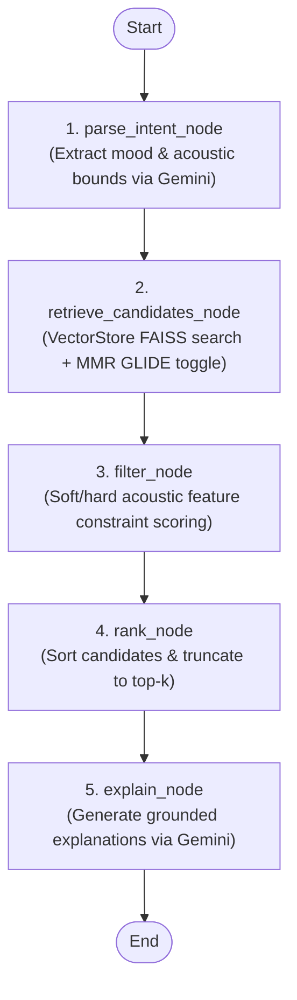

# Spec Document: Phase 3 — LangGraph Agent & Google Gemini Integration

**Status:** APPROVED  
**Date:** 2026-11-03  
**Target Phase:** Phase 3  
**Inspiration:** Spotify NEO (Unified LLM for recommendation, search, and explanation) & Spotify AI Playlist (Tool-using agent)

---

## 1. Overview & Context
Spotify's NEO and AI Playlist represent an architectural leap from rigid keyword search and black-box collaborative filtering to an **orchestrated LLM agent**. The agent interprets complex, nuanced natural language intents (e.g. *"something calm for a 3 a.m. study session with soft vocals"*), maps them to acoustic constraints and semantic retrieval queries, navigates catalog items using discrete **Semantic IDs**, and explains *why* each track was selected.

In Phase 3, we implement:
1. **LangGraph StateGraph Agent** orchestrating a multi-step recommendation workflow.
2. **Intent Parsing Engine** using Google Gemini to extract acoustic boundaries (`energy`, `valence`, `tempo`), mood tags, listening contexts, and enriched dense queries.
3. **Grounded Explanation Generator** generating personalized, psychoacoustically grounded justifications referencing the user's scenario and the track's Semantic ID code.
4. **Resilient Fallback Handling**: Ensuring seamless fallback to heuristic intent parsing and rule-based explanations if Gemini API keys are missing or network calls time out.

---

## 2. Depends on
- Phase 1 (`SPEC_01_DATASET_AND_SEMANTIC_IDS.md`, `SemanticIDGenerator`)
- Phase 2 (`SPEC_02_VECTOR_STORE_AND_GLIDE.md`, `VectorStore`, `EmbeddingEngine`)
- External: Google Gemini API via `google-genai` / `langchain-google-genai` (`GEMINI_API_KEY`).

---

## 3. Agent State Schema (`RecommenderState`)

```python
class RecommenderState(TypedDict, total=False):
    # Inputs
    query: str                       # User prompt
    discovery_mode: str              # "familiar" | "explore"
    user_id: str                     # Unique user identifier
    k: int                           # Target recommendation count (default: 8)
    
    # Internal Pipeline States
    parsed_intent: dict[str, Any]    # Extracted mood, bounds, context
    dense_query: str                 # Enriched query for FAISS embedding
    candidates: list[dict[str, Any]] # Raw FAISS retrieved items with SIDs
    filtered_tracks: list[dict]      # Audio-feature filtered candidates
    ranked_tracks: list[dict]        # Final ordered tracks with scores
    overall_reasoning: str           # Summary explanation for "Why these?" panel
```

### A. Intent Schema (`parsed_intent`)
```json
{
  "mood": ["calm", "contemplative", "focused"],
  "energy_range": [0.05, 0.35],
  "valence_range": [0.15, 0.50],
  "acousticness_min": 0.60,
  "tempo_range": [50, 95],
  "preferred_genres": ["ambient", "piano", "lo-fi"],
  "listening_context": "late-night study",
  "dense_query": "calm ambient acoustic piano with gentle textures and low energy for late-night studying"
}
```

---

## 4. LangGraph Agent Graph Architecture



---

## 5. Classes & Functions to Implement

### A. `backend/app/config.py`
Class `Settings` (inheriting from `pydantic_settings.BaseSettings`):
- `gemini_api_key: str = ""`
- `gemini_model: str = "gemini-2.0-flash"`
- `catalog_path: str = "backend/data/catalog_indexed.csv"`
- `faiss_index_path: str = "backend/data/faiss_index.bin"`
- `faiss_metadata_path: str = "backend/data/faiss_metadata.pkl"`
- `sid_codebooks_path: str = "backend/data/sid_codebooks.pkl"`

### B. `backend/app/agent/prompts.py`
- `INTENT_PARSER_SYSTEM_PROMPT`: Directs Gemini to extract structured JSON with energy bounds, valence bounds, acousticness min, tempo range, and dense search query.
- `EXPLANATION_SYSTEM_PROMPT`: Directs Gemini to formulate concise, grounded explanations (1-2 sentences) referencing the track's sonic textures, Semantic ID, and user scenario.

### C. `backend/app/agent/nodes.py`
- `parse_intent_node(state: RecommenderState) -> dict`: Extracts structured intent via Gemini with rule-based regex fallback.
- `retrieve_candidates_node(state: RecommenderState) -> dict`: Queries `VectorStore` using `dense_query` and mode ($\lambda = 1.0$ vs $0.45$).
- `filter_node(state: RecommenderState) -> dict`: Applies soft feature scoring to elevate tracks matching `energy_range` and `valence_range`.
- `rank_node(state: RecommenderState) -> dict`: Truncates to top-$k$ tracks.
- `explain_node(state: RecommenderState) -> dict`: Attaches grounded explanations to each track and populates `overall_reasoning`.

### D. `backend/app/agent/graph.py`
- `build_recommender_graph() -> CompiledGraph`: Compiles `StateGraph(RecommenderState)` and exports ready-to-run agent.

---

## 6. Files to Create
1. `specs/SPEC_03_LANGGRAPH_GEMINI_AGENT.md`
2. `backend/app/config.py`
3. `backend/app/agent/prompts.py`
4. `backend/app/agent/state.py`
5. `backend/app/agent/nodes.py`
6. `backend/app/agent/graph.py`
7. `backend/tests/test_agent.py`

---

## 7. Rules for Implementation
1. **JSON Robustness**: Always parse LLM intent responses with regex JSON block extraction and schema validation.
2. **Offline Fallback Guarantee**: The agent must run reliably with or without `GEMINI_API_KEY` (using deterministic heuristic parsing when API key is not present) so unit tests and offline demos never fail.
3. **Grounded Explanations**: Explanations must strictly mention the track's real attributes (e.g. "low energy ambient piano") rather than hallucinating instruments not present in the catalog metadata.
4. **Semantic ID Transparency**: Every recommended track card must preserve its discrete Semantic ID token.

---

## 8. Definition of Done (Checklist)
- [ ] `RecommenderState` schema defined.
- [ ] `parse_intent_node` successfully parses queries like *"something calm for a 3 a.m. study session"* into structured boundaries.
- [ ] `retrieve_candidates_node` fetches matching tracks with discrete SIDs.
- [ ] Agent compiles cleanly into a LangGraph `StateGraph`.
- [ ] Full end-to-end agent execution test passes in `backend/tests/test_agent.py`.
